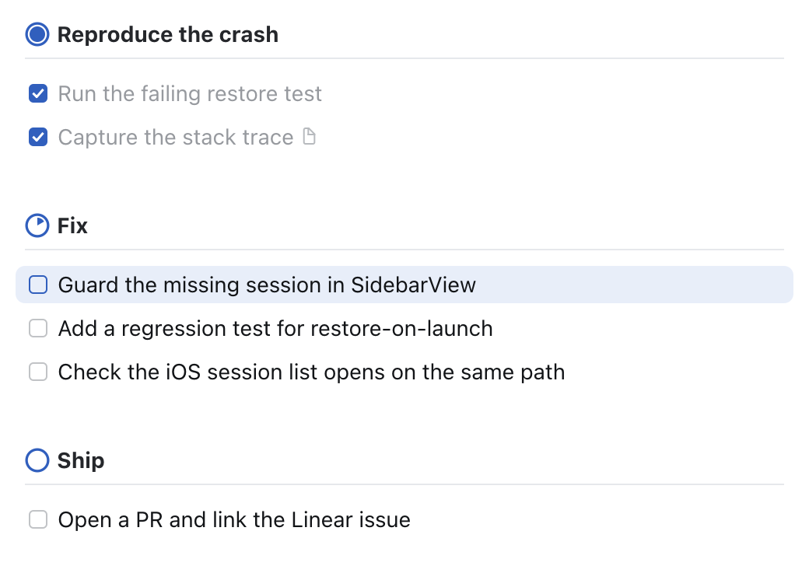
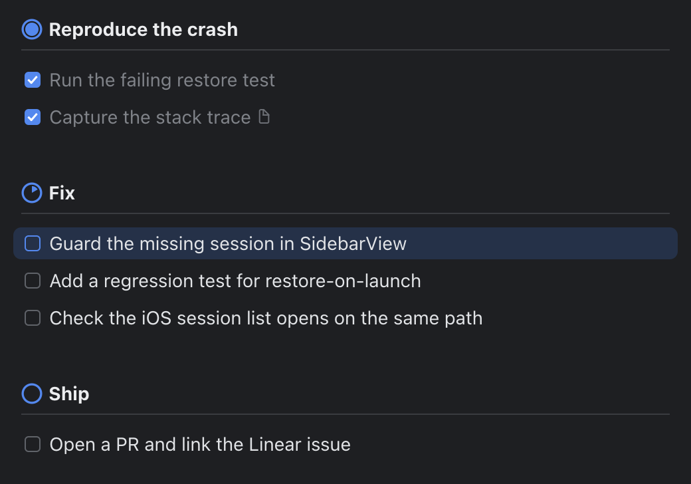

# rexpad

A live todo list for coding agents, drawn in a [Rex](https://superlogical.com)
pane beside the agent.

When an agent starts a multi-step task, it writes its plan to rexpad and opens
a pane next to its own. As it works, it checks items off and moves the
highlight to whatever it's doing now. You can see the plan, the progress, and
what's left at a glance, without scrolling back through the transcript.

<p align="center">
  
  
</p>

- **Drawn, not printed.** The list is a real image sent with the kitty
  graphics protocol: SF Pro text, progress rings, and checkboxes, rendered at
  your display's pixel density.
- **Follows your theme.** Colors come from the Rex theme you're using and
  update when you switch themes.
- **Made for agents.** A short CLI, a Markdown checklist format, and an agent
  skill that teaches Claude Code (or any agent that reads skills) when and how
  to use it.
- **One list per agent.** Each agent pane gets its own list automatically.

## Requirements

- [Rex](https://superlogical.com) on macOS or Linux. The viewer works in
  any terminal that supports the kitty graphics protocol, but opening the pane
  automatically needs Rex.
- Go 1.27 or later to build it.
- For the exact look on macOS, the static **SF Pro** fonts from
  [developer.apple.com/fonts](https://developer.apple.com/fonts/). The system's
  built-in SF can't be loaded by the renderer. Without them rexpad uses Inter
  if installed, then Go's bundled fonts.

## Install

### 1. Install the binary

```bash
go install github.com/almonk/rexpad@latest
```

This puts `rexpad` in `$(go env GOPATH)/bin` (usually `~/go/bin`). Make sure
that directory is on your `PATH`.

Or build from a clone:

```bash
git clone https://github.com/almonk/rexpad
cd rexpad
make install   # builds ~/.local/bin/rexpad and links the skill (see below)
```

### 2. Install the agent skill

The skill is what tells your agent to use rexpad. It's built into the binary:

```bash
rexpad skill install
```

That writes `~/.claude/skills/rexpad/SKILL.md`, where Claude Code finds it.
New Claude Code sessions pick it up automatically; check with `/skills`, or
invoke it directly with `/rexpad`.

For other agents, install it into their skills directory instead:

```bash
rexpad skill install --dir ~/.codex/skills   # Codex
rexpad skill show                            # print it, to paste anywhere else
```

`make install` links the skill to the repo instead of copying it, so edits to
`skills/rexpad/SKILL.md` take effect immediately while you work on rexpad.

### 3. Try it

In a Rex terminal:

```bash
rexpad set <<'EOF'
# Try rexpad
- [x] Install the binary
- [~] Open the pane
- [ ] Ask an agent for a multi-step task
EOF
rexpad show
```

A pane opens on the right, taking 30% of the width, without taking focus. Run
`rexpad next` a few times and watch it update.

## Using it with an agent

You don't need to do anything once the skill is installed: when you give the
agent a task with several steps, it writes its plan and opens the pane. You can
also ask for it directly: "show your plan", "keep a todo list", "what are you
working on?"

Under the hood the agent runs commands like these:

```bash
rexpad set <<'EOF'          # write the whole plan
# Fix
- [~] Guard the missing session in SidebarView
- [ ] Add a regression test
  Cover the restore-on-launch path too
EOF
rexpad show                 # open the pane (does nothing if it's already open)
rexpad next                 # finish the current item, start the next
rexpad add "Bump the dependency pin"
rexpad done 4
```

### The checklist format

```markdown
# Group title
- [ ] pending item
- [~] active item (working on it now; [>] and [/] work too)
- [x] done item
  An indented line under an item is its note. Notes aren't shown as text;
  the item gets a small page icon.
```

Each `# Group` gets a progress ring that fills as its items are done, with
the active item counting half. `rexpad get` prints the list back with each
item's ID as `{#ID}`, and `rexpad set --json` takes the same list as JSON.

## Commands

```
rexpad [--list NAME] COMMAND

Showing the list
  show [--below] [--ratio PCT] [--theme T]  open the viewer beside your pane (30%, no focus change)
  hide                                      close the viewer pane
  view [--theme terminal|light|dark]        run the viewer in the current terminal (q quits)
  render -o FILE.png [--width PT]           write a PNG of the list

Writing the whole list
  set [--json]      replace the list from stdin (Markdown checklist or JSON)
  get [--json]      print the list with item IDs
  clear             empty the list

Changing items
  group TITLE                    add a group; later adds go to it
  add [-g GROUP] [-n NOTE] TEXT  add an item, prints its ID
  start ID                       make ID the active item
  done [ID...]                   check items off (no ID: the active item)
  next                           finish the active item, start the next one
  undo ID...                     mark pending again
  edit ID TEXT / note ID [TEXT] / rm ID...
  progress GROUP PCT|auto        pin a group's ring, or go back to counting items

Agent skill
  skill install [--dir DIR]      install the skill (default ~/.claude/skills)
  skill show                     print the skill
```

`rexpad help` prints the full reference.

## Configuration

| Setting | Default | |
| --- | --- | --- |
| `--list NAME`, `$REXPAD_LIST` | the agent's pane (`$REX_BLOCK`) | Which list to use. Give several agents the same name to share one list. |
| `--theme` | `terminal` | `terminal` follows the Rex theme; `light` and `dark` use fixed palettes. |
| `--ratio PCT` | `30` | The pane's share of the split. |
| `--scale N`, `$REXPAD_SCALE` | from the cell size | Device pixels per point. |
| `$REXPAD_FONT`, `$REXPAD_FONT_BOLD` | SF Pro Text | Paths to other font files. |
| `$XDG_STATE_HOME` | `~/.local/state` | Lists are stored in `rexpad/` under it. |

## How it works

- **State**: each list is a JSON file in `~/.local/state/rexpad`. Commands
  read it, change it, and write it back atomically.
- **The viewer** (`rexpad view`) is what runs in the pane. It checks the file
  every 150 ms, renders the list to a PNG at the pane's pixel size, and sends
  it with the kitty graphics protocol. Each image is pinned to the pane's
  columns and rows, so a client with different cell metrics (such as Rex on a
  phone) scales it to fit instead of overflowing. New frames are placed before
  old ones are deleted, so updates don't flicker. Long lists scroll to keep the
  active item in view.
- **Theme**: the viewer asks the terminal for its foreground, background, and
  blue (OSC 10, 11, and 4), and mixes the grays from those in the same
  proportions as the light design. It asks again every 2 seconds and whenever
  the terminal reports a color-scheme change.
- **The pane**: `show` runs `rex split` beside `$REX_BLOCK` without taking
  focus, then sets the 70/30 ratio with `rex block move`, and remembers the
  pane so it doesn't open a second one.

## Development

```bash
make build     # ./rexpad
make test
make install   # ~/.local/bin/rexpad, plus a symlinked skill
```

The layout constants in `render.go` are in points, measured against a 2x
reference design. `rexpad render -o out.png` is the quickest way to check a
change.

## License

[MIT](LICENSE)
